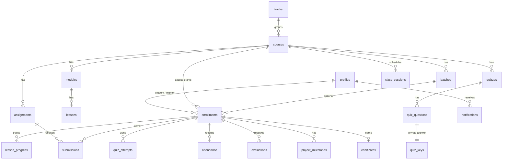

# Architecture
React SPA (Vite, TS strict, Tailwind, React Router, React Hook Form + Zod, TanStack Query) → Supabase JS (anon key + user JWT) → Postgres with RLS.
Privileged work (creating accounts) runs only in the `admin-create-user` Edge Function, which verifies the caller is an active admin. Everything else is enforced by RLS, triggers and SECURITY DEFINER RPCs (`submit_quiz`, `enrollment_eligibility`, `verify_certificate`). No Storage, no uploads.

```
src/pages/{admin,mentor,student}   role dashboards      src/components   shared UI, panels, DataTable
src/lib   supabase client, auth context, zod schemas, sanitizer     supabase/   migrations, seed, function, tests
```

## ERD


## Enrollment lifecycle
`(none) → active` (admin grants; mentor + batch chosen per course) `⇄ paused` → `revoked` (history kept; a new enrollment may be created later) · `active → completed` only through "Complete + certify", which requires the course's explicit rules (min progress %, min attendance %, all assignments graded with avg ≥ threshold). Completing the last live enrollment sets `profiles.is_alumni`.
Rules enforced in DB: one live (active/paused) enrollment per student+course (partial unique index); mentor must be an active mentor; batch must belong to the course; progress/submissions/attendance/evaluations/quiz attempts/milestones/certificate all reference `enrollment_id`, so one revoke never touches another course.

## Security model
See SECURITY_CHECKLIST.md. Roles: admin / mentor / student in `profiles.role`; changing role/status/email/alumni is blocked for non-admins by trigger. Suspended users fail `is_active_user()` and see nothing.
